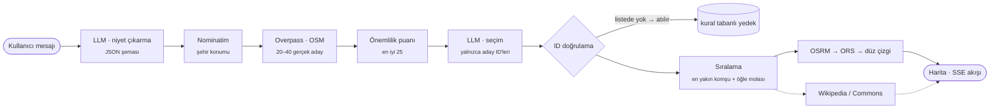

<div align="center">

# rota

**Ne sevdiğini söyle, günü haritada kuralım.** Sohbetle gerçek mekanlardan gezi rotası kuran, tamamen ücretsiz servislerle çalışan yapay zekâ destekli şehir rehberi.

[](https://github.com/your-username/rota/actions/workflows/ci.yml)


<!-- GIF: docs/demo.gif dosyasını ekleyip aşağıdaki satırı aç -->
<!--  -->
**[ GIF yer tutucu — `docs/demo.gif` ]**

**[Canlı demo →](https://your-rota-demo.vercel.app)** <sub>(yer tutucu)</sub>

</div>

---

“İstanbul'da tarih dolu bir gün” ya da “Kapadokya'da gün batımına kadar, araçla” yaz. Rota isteğini anlar, OpenStreetMap'ten **gerçek** mekanları çeker, dil modeli bu listeden durakları seçip sıralar, yol rotası hesaplanır ve duraklar haritaya sırayla düşerken rota animasyonla çizilir.

## Özellikler

- **Sohbetle rota.** Serbest metinden yapılandırılmış niyete: şehir, ilgi alanları, süre, ulaşım şekli, başlangıç saati, özel istekler.
- **Canlı araç çağrıları.** Her adım ayrı bir Server-Sent Events olayı olarak akar: `intent_parsed`, `places_found`, `stops_selected`, `route_ready`, `text_delta`, `done`. Arayüz arka planda olanları canlı gösterir.
- **Gerçek mekanlar, gerçek yollar.** Overpass (OSM) adayları, OSRM yürüyüş ve araç rotaları, Wikipedia özeti ve Commons fotoğrafı.
- **Takip mesajları.** “Topkapı olmasın”, “öğle yemeğini değiştir”, “araçla olsun”: mevcut rota güncellenir, sıfırdan başlanmaz.
- **Kartografik arayüz.** MapLibre + OpenFreeMap. Palete göre yeniden boyanmış, sade ve düşük kontrastlı açık/koyu harita stilleri. Pinler 0,3 sn arayla sekerek düşer, rota ~2,5 sn'de çizilir, istatistikler sayarak artar.
- **Demo modu.** `NEXT_PUBLIC_DEMO_MODE=true` iken backend'e hiç gidilmez. İstanbul, Kapadokya ve Mardin için gerçek OSM/OSRM/Wikipedia verisinden üretilmiş hazır rotalar, gerçekçi gecikmelerle oynatılır.
- **Erişilebilir.** Tam klavye desteği, görünür odak halkası, `prefers-reduced-motion` desteği, sistem temasını takip eden açık/koyu tema ve elle tema seçimi.
- **Kota dostu.** SQLite önbelleği (Nominatim, Overpass, Wikipedia, rotalar, tam yanıtlar) ve IP başına hız sınırlama.

## Mimari



```
rota/
├── frontend/                 Next.js (App Router) · TypeScript · Tailwind · MapLibre · Framer Motion
│   └── src/
│       ├── components/       chat/ (araç çağrıları, durak listesi) · map/ (harita, pin, bilgi kartı)
│       └── lib/              SSE istemcisi, durum yönetimi, harita stili, demo motoru + verisi
└── backend/                  FastAPI · Pydantic
    ├── app/providers/        llm/ (Gemini, Groq, yedekleme) · osm/ (Nominatim, Overpass) · routing/ · wiki/
    ├── app/pipeline/         niyet → adaylar → seçim → sıralama → orkestrasyon
    ├── app/api/              SSE uç noktası, rota yeniden hesaplama, hız sınırlama
    ├── app/cache/            SQLite TTL önbelleği
    ├── scripts/build_demo.py demo verisini gerçek servislerden üretir
    └── tests/                pytest; tüm dış servisler mock'lanır
```

## LLM neden mekan uydurmuyor?

Dil modelleri ikna edici ama var olmayan mekanlar üretebilir. Rota'da LLM'in yalnızca iki işi var: isteği yapılandırılmış veriye çevirmek ve sistemin verdiği listeden seçim yapıp anlatmak. **Mekan adı, koordinat veya bilgi asla LLM'den gelmez.**

1. **Adaylar sistemden gelir.** Overpass'tan çekilen her mekanın bir OSM kimliği vardır (`n123`, `w456`, `r789`). LLM'e yalnızca bu kimlikler ve adlar listelenir.
2. **Çıktı şemayla sınırlıdır.** Gemini'ye `responseSchema`, Groq'a JSON modu verilir. Gelen her yanıt Pydantic ile doğrulanır. Şemaya uymayan yanıtta sıradaki sağlayıcıya geçilir.
3. **Her ID doğrulanır.** `validate_picks()` aday listesinde olmayan, tekrar eden ya da fazla olan her seçimi atar. Geçerli durak 3'ten azsa kural tabanlı seçim devreye girer (yine yalnızca gerçek adaylardan).
4. **Ad ve koordinat LLM çıktısından alınmaz.** Durak; adı, konumu ve kategorisiyle aday kaydından kurulur. LLM'den yalnızca bir cümlelik ipucu ve saat tercihi alınır.
5. **Prompt injection'a karşı** sistem talimatı ve kullanıcı metni ayrı mesajlarda gider. Kullanıcı metni `<mesaj>` etiketine sarılır ve etiketi taklit etmesi engellenir. Takip mesajları istemciden gelen duraklarla değil, sunucuda saklanan güvenilir rota kaydıyla çalışır.

Bu davranış `tests/test_selection.py` ve `tests/test_pipeline.py` içinde uydurma ID senaryolarıyla test edilir.

## Tamamen ücretsiz servisler

| İş | Servis | Not |
|---|---|---|
| Niyet ve seçim | **Google Gemini Flash** (AI Studio) | Ücretsiz anahtar. 429 veya hata gelirse otomatik olarak Groq'a geçilir |
| Yedek LLM | **Groq** (OpenAI uyumlu) | Yeni sağlayıcılar `OpenAICompatibleProvider` ile tek satırda eklenir |
| Mekanlar | **Overpass API** (OpenStreetMap) | Birden çok sunucu sırayla denenir |
| Geocoding | **Nominatim** | En fazla 1 istek/sn, açıklayıcı User-Agent |
| Rota | **OSRM** (routing.openstreetmap.de) | Yürüyüş ve araç. Yedekleri: OpenRouteService, son çare düz çizgi + tahmini süre |
| Açıklama ve foto | **Wikipedia REST** + **Wikidata** + **Commons** | OSM'deki `wikidata`/`wikipedia` etiketiyle eşleşir |
| Harita | **MapLibre GL JS** + **OpenFreeMap** | Anahtar gerektirmez |
| Barındırma | **Vercel** (frontend), **Hugging Face Spaces / Render** (backend) | Dockerfile hazır |

## Kurulum

### En hızlı yol: Docker

```bash
cp .env.example .env        # GEMINI_API_KEY ve/veya GROQ_API_KEY ekle
docker compose up --build   # → http://localhost:3000
```

### Yalnızca demo (anahtar gerekmez)

```bash
cd frontend
npm install
echo "NEXT_PUBLIC_DEMO_MODE=true" > .env.local
npm run dev                 # → http://localhost:3000
```

### Geliştirme (canlı mod)

```bash
# backend
cd backend
python -m venv .venv && source .venv/bin/activate   # Windows: .venv\Scripts\activate
pip install -r requirements-dev.txt
cp ../.env.example .env                              # anahtarları ekle
uvicorn app.main:app --reload --port 8000

# frontend (ayrı terminal)
cd frontend
npm install
printf "NEXT_PUBLIC_DEMO_MODE=false\nNEXT_PUBLIC_API_URL=http://localhost:8000\n" > .env.local
npm run dev
```

### Testler

```bash
cd backend && pytest -q && ruff check .
cd frontend && npm run lint && npm run build
```

### Dağıtım

- **Frontend → Vercel:** kök dizin `frontend`. Ortam değişkenleri: `NEXT_PUBLIC_DEMO_MODE=true` (backend uyusa bile demo çalışır) ya da `false` + `NEXT_PUBLIC_API_URL`.
- **Backend → Hugging Face Spaces (Docker) / Render:** `backend/Dockerfile`. Anahtarları gizli değişken olarak, `CORS_ORIGINS` değerini Vercel adresin olarak ekle.
- **Demo verisini yenileme:** `cd backend && python scripts/build_demo.py`

## Bilinen sınırlamalar

- Ücretsiz Overpass ve OSRM sunucuları yoğun saatlerde yavaşlayabilir ya da yanıt vermeyebilir. Bu durumda kullanıcıya “Şu an çok yoğunuz…” mesajı gösterilir, rota tarafında ORS veya düz çizgi yedeği devreye girer.
- Açılış saatleri, bilet fiyatları ve anlık kalabalık bilgisi yok. İpuçları genel nitelikte.
- Saat planı kategoriye göre ortalama ziyaret süresi ve gerçek yol süresiyle hesaplanır. Kişisel tempo dikkate alınmaz.
- `2_gun` planları şimdilik tek bir uzun liste olarak döner, günlere bölünmez.
- Hız sınırlama ve takip mesajı kayıtları tek sunucu içindir (bellek + SQLite). Yatay ölçekleme için Redis gibi paylaşımlı bir depo gerekir.
- Demo verisindeki “gerçek mekan bulundu” sayısı, Overpass erişilemezse varsayılan bir değere düşer. Betik yeniden çalıştırıldığında güncellenir.

## Gelecek planları

- Çok günlü planları günlere bölme ve otel/başlangıç noktası seçimi
- `opening_hours` etiketiyle açık/kapalı kontrolü
- Rotayı paylaşılabilir bağlantı ve GPX olarak dışa aktarma
- Toplu taşıma profili (GTFS)
- Sesli giriş ve çoklu dil (EN)
- Kullanıcı geri bildirimiyle aday puanlamasını iyileştirme

## Atıf ve lisans

Harita verisi © [OpenStreetMap katkıcıları](https://www.openstreetmap.org/copyright), [ODbL](https://opendatacommons.org/licenses/odbl/) lisansıyla. Harita karoları [OpenFreeMap](https://openfreemap.org) ve [OpenMapTiles](https://openmaptiles.org). Rotalar [OSRM](https://project-osrm.org) ve [FOSSGIS routing](https://routing.openstreetmap.de). Açıklamalar [Wikipedia](https://www.wikipedia.org) (CC BY-SA), fotoğraflar [Wikimedia Commons](https://commons.wikimedia.org) kaynaklıdır.

Kod [MIT](LICENSE) lisanslıdır.
